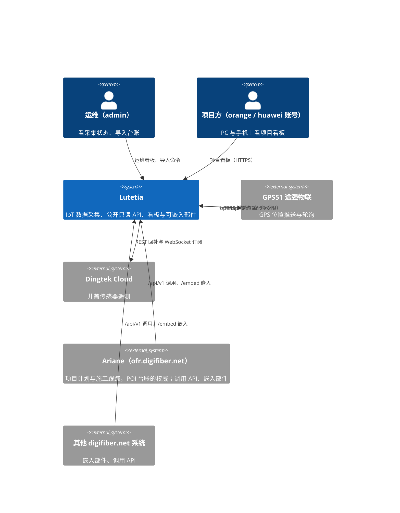
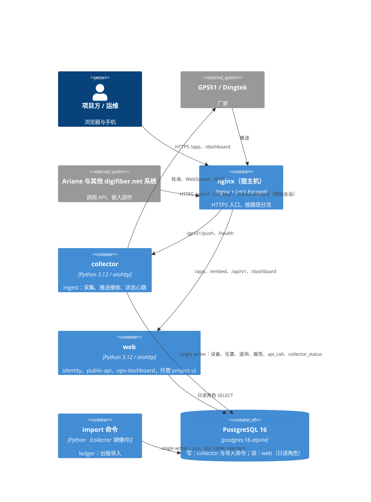
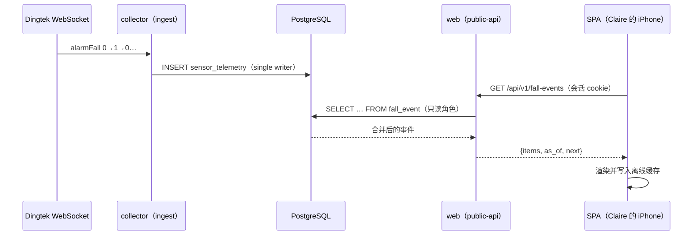
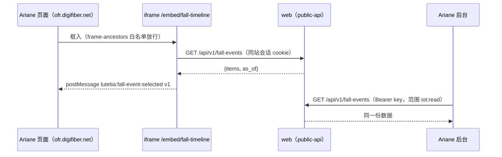

# Architecture Design — Lutetia 巴黎项目 IoT 数据采集服务

> 生成：2026-11-08 · 档位：M · 路：Coaching · 状态：已批准（用户 2026-11-08「批准」）
> 需求来源：Product-Spec.md v1.10（本版覆盖 SCOPE-14、15、17、18 与 SC-10、11、13；SCOPE-16 已在 Phase 5 完成），加用户 2026-11-08 口头新增：「除了有自己的看板，还会被别人嵌入、被别人调用，做好充分扩展和接口」（尚未进 Spec，见 §16）。棕地：现有代码约 3,500 行（aiohttp + asyncpg + PostgreSQL，服务端渲染加原生 JS），本文档 ratify 现有约定、只画增量与迁移。
> 本文档只写不变量（两个独立构建的单元会在这上面选得不兼容的决定），其余是种子，代码一出现就归代码。本版不产出 module-catalog.json（M 档可选），依赖规则靠只读数据库角色、契约测试与人工评审守。

## 1. 架构概览

- **架构风格与命名范式**：模块化单体，同一镜像按职责跑两个容器（collector 写、web 只读）；读侧「API 优先」——版本化的公开 API `/api/v1` 是唯一数据契约，自家项目看板、嵌入部件、外部系统都只消费它。范式「单一写入者 + 只读读模型 + 公开契约」：写侧 `lutetia/sources`、`lutetia/parsers`、`lutetia/poi_*`；读侧 `lutetia/web`；前端 `web-ui/` 只是契约的一个消费者。被拒备选见 ADR-1、ADR-5。
- **技术栈**（2026-11-08 联网核过；带 x 的小版本在安装时锁死并写进 DEV-PLAN）：

| 名称 | 版本 | 角色 |
|---|---|---|
| Python | 代码按 3.9 写法；容器 python:3.12-slim | 采集、导入、web 服务 |
| aiohttp / asyncpg | ≥3.9 / ≥0.29（现有） | HTTP 服务与推送接收 / PostgreSQL 驱动 |
| PostgreSQL | 16（postgres:16-alpine） | 唯一业务存储 |
| Node.js | 24 LTS（仅构建阶段，node:24-slim） | 构建前端，不进运行镜像 |
| Vite | 8.0.x | 前端构建 |
| Vue | 3.5.x（3.6 仍在 beta，不用） | 项目看板与嵌入部件（同一个单页应用） |
| vite-plugin-pwa | ≥1.3.0（1.2 不支持 Vite 8） | Web App Manifest 与 Service Worker |
| ECharts / vue-echarts | 6.1.x / 8.x | 图表 |
| Leaflet | 1.9.4（已自托管） | 地图（两个看板与部件共用） |
| Chart.js | 4.6.1（已自托管） | 运维看板现有曲线，不迁 |
| OpenAPI | 3.1 | `/api/v1` 的机器可读契约，随代码入库 |

- **一句话数据流**：厂家推送 / 轮询 / WebSocket 与运维的 Excel 导入 → 写侧（collector 容器与导入命令）单一写入 PostgreSQL → 读侧（web 容器，只读库角色）把数据只经 `/api/v1` 暴露 → 自家项目看板、`/embed/*` 部件（被 digifiber.net 下的系统嵌入）与外部系统（Ariane 等）只读消费。
- **系统上下文（C4 L1）**：



## 2. 模块划分

| 模块 id | 职责（一句话） | 对外契约 | dependsOn | 禁依赖 | 变化原因（SRP 检验） | riskTier | 设计详述 |
|---|---|---|---|---|---|---|---|
| ingest | 把 GPS51 与 Dingtek 的数据落库并报告自己的状态 | 推送接收端 `/gps51/push/<随机段>`、`/health`（collector）；写 `collector_status` | store（写） | ledger、web 下全部模块 | 厂家接口与配额规则变 | high | 无 |
| ledger | 把 POI 台账 xlsx 导进库（Ariane 接口就绪前是快照） | `lutetia import poi FILE [--dry-run]` | store（写） | ingest、web 下全部模块 | 台账格式或来源变 | medium | 无 |
| store | 表结构、迁移、查询函数，按读与写分开暴露 | `lutetia/sql/NNN_*.sql`；`Database` 读 / 写函数 | 无 | 任何业务模块 | 数据模型变 | high | 无 |
| events | 把 alarmFall 翻转按窗口合并成井盖挪动事件 | SQL 视图 `fall_event`（列：device_id、started_at、ended_at、flips） | store（遥测表） | ingest、ledger | 挪动事件判据变 | medium | 无 |
| identity | 人（三个固定账号）与调用方（登记的系统）的认证、会话、登录锁定、调用方范围与限流 | 会话 cookie；`require_session`；调用方登记表（名字、key 摘要、范围、来源白名单、限流） | 配置（环境变量 / 登记文件） | ingest、ledger、store 写函数 | 登录、权限、调用方规则变 | high | 无 |
| public-api | 版本化的公开只读 API，所有读者的唯一数据契约 | `/api/v1/*`（会话或 API key 都认）+ `/api/v1/openapi.json` | store（读）、events、identity | ingest、ledger、store 写函数 | 有人需要新数据或新聚合 | high | 无 |
| ops-dashboard | 现有运维看板 `/dashboard`（服务端渲染） | HTML 页面、`/dashboard/data/*`（仅本模块内部用，不对外承诺） | store（读）、events、identity | ingest、ledger、store 写函数 | 运维关注点变 | medium | 无 |
| project-ui | 项目看板单页应用（PC 与手机共用，PWA）与可嵌入部件 `/embed/*` | 构建产物由 web 托管在 `/app/` 与 `/embed/`；postMessage 消息 v1 | 只经 HTTP 用 public-api | 直接访问库、`/dashboard/data`、API key | 页面、部件与交互变 | medium | 无 |

- **容器图（C4 L2，图即规则：谁可依赖谁）**：



## 3. 依赖规则

- **分层**（外 → 内，依赖只许向内）：project-ui 与外部系统 →（HTTPS）→ public-api → identity、events、store 读函数；ops-dashboard → identity、events、store 读函数；ingest、ledger → store 写函数。web 容器里的模块不 import `lutetia.sources`、`lutetia.parsers`、`lutetia.poi_import`、`lutetia.poi_store`、`lutetia.import_cmd`。
- **禁边**：web ✗→ ingest（看板不调厂家接口，Pinned「看板只读」）；web ✗→ ledger（导入只走命令，OUT-11）；project-ui ✗→ `/dashboard/data` 与 API key（自家前端只用公开契约、只用会话）；ingest ✗↔ ledger；任何外部系统 ✗→ 数据库、文件、`/dashboard/data`（只经 `/api/v1` 与 `/embed`）；任何读者 ✗→ 写入（`/api/v1` 只注册 GET）。
- **数据所有权**：

| 数据 | 唯一写入者 | 读者 | 备注 |
|---|---|---|---|
| device、gps_position、sensor_telemetry、sensor_attribute、api_call | ingest | public-api、ops-dashboard | 现状不变 |
| collector_status（新增） | ingest，每 30 秒覆盖一行 | ops-dashboard、public-api（采集状态资源） | 取代 web 读 collector 进程内存（ADR-4） |
| poi、poi_cable_segment | ledger（导入命令） | public-api | 权威在 Ariane；本表是快照，资源带 `source` 与 `as_of` |
| fall_event（视图） | 无（派生） | public-api、ops-dashboard | 规则只在视图里（ADR-3） |
| 会话 | identity 签发，不落库 | — | 签名密钥按账号派生 |
| 调用方登记（名字、key 摘要、范围、来源白名单、限流） | 运维（改登记文件或环境变量后重启 web） | identity | 本版不建调用方管理页面（只读原则） |

## 4. 一致性约定

| 关注点 | 约定（独立构建者会各写各的那些默认） |
|---|---|
| 命名 | Python 模块与 SQL 用 snake_case；Vue 组件 PascalCase、放 `web-ui/src/`；HTTP 路径用小写短横线、资源名用复数名词（`/api/v1/fall-events`）；JSON 字段 snake_case，与表列同名；部件名小写短横线（`/embed/fall-timeline`） |
| API 版本 | 路径带主版本 `/api/v1`；v1 内只增不改：可加资源、加字段、加可选参数，不删字段、不改类型与含义、不收紧参数；破坏性改动开 `/api/v2`，v1 至少保留到所有登记调用方迁完并提前通知 |
| 契约文档 | `/api/v1/openapi.json`（OpenAPI 3.1）随代码入库并在线提供；契约测试拿它校验响应，接口改了文档没改就红 |
| 时间 | JSON 一律 UTC ISO 8601 带 `Z`（沿用 `lutetia/web/jsonutil.py`）；页面按 Europe/Paris 显示并标时区；库里 timestamptz |
| 标识 | device_id 与 poi_no 都是字符串，原样透传，不转数字 |
| 数值 | 重量单位吨、长度公里，JSON 数字；原始传感器值照存，换算只在视图或展示层做一次 |
| 响应信封 | 列表：`{"items": [...], "as_of": "<UTC>", "next": "<游标或 null>"}`；单个资源直接返回对象并带 `as_of`；来自快照的资源另带 `source`（如 `excel-snapshot` / `ariane`） |
| 分页 | 游标分页，`limit` 默认 100、上限 1000；不用 offset |
| 错误形状 | 非 2xx 一律 `{"error": "<可读原因>"}`（沿用现有）；401 未认证、403 认证了但范围不够、429 超限（带 `Retry-After`） |
| 认证 | 浏览器（自家页面与同站嵌入）只用会话 cookie（HttpOnly、Secure、SameSite=Lax）；系统调用只用 `Authorization: Bearer <key>`；两者都不认则 401；不许免认证访问（用户 2026-11-08） |
| 调用方 | 每个调用方一把 key、一组只读范围（如 `iot:read`、`poi:read`、`status:read`）、一个来源白名单、一个限流额度；日志与 `api_call` 一类审计记录写调用方名字，不写 key |
| 跨域 | 浏览器跨域调用只对登记调用方的来源白名单返回 CORS 头，带凭据；默认不返回 |
| 嵌入 | 只有 `/embed/*` 允许被框入，`frame-ancestors` 取登记的来源白名单（本版 `https://*.digifiber.net`）；其余页面仍 `frame-ancestors 'none'` 与 `X-Frame-Options: DENY` |
| 部件与宿主通信 | postMessage 信封 `{"type": "lutetia:<事件名>", "v": 1, ...}`；只向白名单来源发、只收白名单来源的消息；事件名与字段同 API 规则只增不改 |
| 写入 | 只有 ingest 与 ledger 写库；web 连库用只读角色 `lutetia_ro`（迁移里 `GRANT SELECT`） |
| 迁移 | `lutetia/sql/NNN_*.sql`，幂等，按文件名顺序启动时执行；角色、视图、表都在这里建 |
| 配置 | 只从环境变量与入库外的登记文件读；新变量进 README 环境变量表；凭据不进代码、日志、测试、回执 |
| 日志 | Python logging 写标准输出；不写台账行内容与凭据；命令类输出日志走标准错误 |
| 前端资源 | 运行时不连任何 CDN；脚本、样式、字体随构建产物自托管 |
| 离线缓存 | Service Worker 只缓存应用外壳与每个资源最近一次响应；退出登录清空；嵌入部件不缓存、不注册 Service Worker |

## 5. 扩展点（开闭原则落点）

| 易变轴 | 扩展机制 | 新增一种时改哪 |
|---|---|---|
| 新的调用方（Ariane 是第一个） | 调用方登记：名字、key、范围、来源白名单、限流 | 登记文件加一条、重启 web，不改代码 |
| 新的数据需求 | `/api/v1` 加资源或字段（只增不改）+ OpenAPI 同步 | 加一个只读 GET 处理函数与契约条目 |
| 新的嵌入部件 | 单页应用里的部件注册表：一个部件 = 一个路由 + 一个组件，只读 `/api/v1` | 加一个组件文件并登记路由 |
| 外部域名嵌入（本版不做） | 嵌入令牌：宿主后台用 API key 换一个短时、只读、限定部件与来源的签名令牌放进 iframe 地址 | identity 加签发与校验，部件路由认令牌；不动 API 与部件 |
| 主动推送（本版不做） | webhook 订阅：事件（如新的挪动事件）按登记地址推送，带签名与重试 | 新增投递模块（写侧，独立于 web），API 不变 |
| POI 来源（Excel 快照 → Ariane 接口） | ledger 的来源适配：都产出同一种 PoiRecord，交 `poi_store.apply_ledger` | 新增一个来源适配文件 |
| 挪动事件判据（窗口、阈值） | 视图参数与迁移 | 改视图定义一处 |

## 6. 关键场景走查

### 场景 1：Claire 周一早上看井盖挪动（FLOW-4）
井盖翻转由 ingest 写进遥测；`fall_event` 视图查询时合并；public-api 只读视图并带 `as_of`；SPA 用会话调 `/api/v1/fall-events` 并写入离线缓存。华为账号打开同一页，读的是同一个视图同一个接口，所以两边看到的事件必然一致。



### 场景 2：Ariane 嵌入挪动事件时间线，并在后台调用 API
Ariane 页面放 `<iframe src="https://iot.digifiber.net/embed/fall-timeline?site=…">`。iot. 与 ofr. 同属 digifiber.net（同站），用户在 iot. 的会话 cookie 在 iframe 里照常带上；没有会话时部件显示「请登录」并给登录链接（新窗口），不在 iframe 里收密码。部件点击某条事件时向宿主发 `{"type": "lutetia:fall-event-selected", "v": 1, "device_id": …, "imei": …, "started_at": …}`（`device_id` 是内部 id，`imei` 是井盖设备号，都不含位置；2026-11-10 Phase 12 实现时加 `imei`）；内容高度变化发 `{"type": "lutetia:resize", "v": 1, "height": …}`。部件可被框入的来源由环境变量 `EMBED_FRAME_ANCESTORS` 单独配置（默认 `https://*.digifiber.net`，可收窄到具体子域，THR-4），与 API 调用方的 CORS 登记分开。同时 Ariane 后台用自己的 API key 调 `/api/v1/fall-events` 拿同一份数据做自己的报表。两条路径读的是同一个契约，所以数字一致。



### 场景 3：看板被刷爆时推送照收（ADR-1 的反证场景）
有人持续请求 `/api/v1` 或撞登录，web 容器 CPU 吃满；collector 是另一个容器，推送接收与写库不受影响；调用方限流在 web 内先挡掉超额请求（429）。web 显示的采集状态来自 `collector_status`，web 重启不丢采集计数。

### 场景 4：台账更新（FLOW-5，快照期）
运维用导入命令把新版 Excel 导入；Ariane 页面上改过的工单 Lutetia 看不到，所以 POI 资源带 `source: excel-snapshot` 与导入时间，页面与部件据此标「Excel 快照，截至 …；台账以 Ariane 为准」。Ariane 提供读接口后，ledger 换来源适配，`source` 改为 `ariane`，调用方不用改。

## 7. 运行与部署包络

| 项 | 三态 | 内容 / 回来定的条件 |
|---|---|---|
| 环境（本地 / 测试 / 生产） | 决定 | 本地：mac-ts 与 WSL，合成测试库容器 lutetia-pg（127.0.0.1:15433，只放合成数据）；生产：法兰克福 fra，目前处于测试阶段（密码 123456、关登录锁定、Google 瓦片三项豁免，给 Orange 看之前收回，TODO #88） |
| 部署拓扑（单机 / 容器 / 多实例） | 决定 | 单机 docker compose：db、collector、web 三个服务（ADR-1），同一镜像，web 用只读库角色；宿主机 nginx 按路径分流：`/gps51/push`、`/health` → collector，其余 → web；同机的 Ariane 现为 systemd、将来容器化，两个系统之间只走 HTTPS 域名，不共享 docker 网络、数据库与文件 |
| 基础设施与供应商（云 / 内网 / 数据库托管） | 决定 | 腾讯云轻量服务器法兰克福（数据不出欧洲，Pinned）；自建 PostgreSQL 容器；Let's Encrypt 证书；GitHub 只放代码；构建时从 npm 与 PyPI 拉依赖，运行时不连任何 CDN |
| 运维（日志 / 监控 / 备份 / 发布与回滚） | 未定（备份）；其余决定 | 日志：docker logs，按调用方名字可查；监控：`/health`、`lutetia status`、运维看板异常总览，无外部告警（押后）；发布：`deploy/host-deploy.sh`；回滚：`git checkout` 上一个 tag 后手动 `docker compose up -d --build`（不重跑 host-deploy.sh：分离 HEAD 下它第 1 步的 `git pull --ff-only` 会失败退出），迁移只加不删所以旧代码能跑新库；跨 Phase 7 Task 7.3（单容器 → collector + web）回滚时布局不兼容，先 `docker compose rm -sf web` 再起旧布局，否则旧 collector 抢不到看板端口、推送中断（Task 7.3 审查 M-2、复核 R-M2 实测，见 README 回滚预案）；**备份：未定**，生产库是两家厂家数据的唯一存档，没有定时 pg_dump，见 §11 与 §16 |

## 8. 关键决策记录（ADR）

| 已定但够不上 ADR 的 | 结论 | 一句理由 |
|---|---|---|
| 主存储 | PostgreSQL 16，单库 | 现有数据与查询都在这里，没有真备选 |
| 人的账号 | admin / orange / huawei 三个固定身份，凭据在环境变量，不建用户表 | Spec 已定（SCOPE-17、OUT-10） |
| 单页应用托管 | 由 web 容器的 aiohttp 托管 `/app/` 与 `/embed/` 静态文件并做前端路由回退 | 会话、CSP、frame-ancestors 按路径区分，只在一处配 |
| 运维看板 | 保留服务端渲染与 Chart.js，与项目看板并存；它的 `/dashboard/data` 是内部口，不对外承诺 | 用户 2026-11-08 确认并存；对外只承诺 `/api/v1` |
| 构建产物 | Dockerfile 多阶段：node:24-slim 构建 → 只把产物拷进 python:3.12-slim | 运行镜像不带 Node 与 node_modules |
| 嵌入方范围 | 本版只允许 `https://*.digifiber.net` 嵌入，同站会话即可 | 用户 2026-11-08：先只有 digifiber.net 下的系统；外部域名走 §5 嵌入令牌扩展点 |
| 免认证访问 | 不允许，部件与 API 一律认证 | 用户 2026-11-08；井盖与铜缆捆位置就是防盗对象的位置 |

### ADR-1：采集与看板分成两个容器（同一镜像）
- **状态**：accepted
- **背景与问题**：现状采集、推送接收、运维看板、API 跑在同一进程。2026-11-08 审查实测：关闭登录锁定后持续撞登录可让事件循环饱和，拖慢同进程的 GPS51 推送接收（单次失败 4.66 ms、10 万项）。用户判断采集停与看板打不开「一样疼」，维护者只有用户加 AI；且 Lutetia 将被外部系统调用与嵌入，读侧负载不再只来自自家页面。
- **决策驱动**：两边故障互不牵连；看板只读要从「靠自觉」变成数据库保证；一个人维护，工具链与部署件数要少。
- **候选与优劣**：
  - A 维持单进程：好——零改动、部署最简单；坏——看板与外部调用的负载、崩溃直接连累采集。
  - B 同一镜像两个容器（collector 写、web 只读）：好——故障隔离、web 用只读库角色、仍是一个代码库一个镜像；坏——多一个容器，web 不能再读采集进程内存，要新加 collector_status 心跳表。
  - C 前后端彻底分离部署：好——前后端各自独立；坏——一个人维护两套部署，当前规模没有驱动。
- **决策**：选 B，因为它是满足「一样疼」的最小改动，并把只读约束交给数据库。
- **后果**：好——看板或外部调用被打爆不影响收数据，web 写不了库；坏——运维看板的推送计数与静默秒数改读心跳表，最多滞后 30 秒；数据库连接数约翻倍（10 条以内）。
- **被拒备选与理由**：A，因为审查已实测出看板拖垮采集的路径；C，因为一个人维护两套部署是负担，且无对应驱动。
- **执法方式**：人工评审（code-review 对照 §3 禁边：web 下的模块不 import 写侧模块）；web 连库用只读角色，迁移里只 `GRANT SELECT`，越界写入由数据库直接拒绝；部署三件套核两个容器的创建时间与 /health。
- **revisit-if**：单台主机放不下两个容器的内存；或者 web 需要写业务数据（出现看板上的编辑功能，需先改 Pinned「只读」）；或者推送量涨到 collector 需要多实例。
- **reversal**：把 web 的启动合回 collector 的 `run`、compose 删 web 服务、nginx 改回单一上游、运维看板改回读进程内存，约 1 天；数据与 schema 不受影响。

### ADR-2：项目看板与嵌入部件用 Vite + Vue 单页应用
- **状态**：accepted
- **背景与问题**：项目看板（SCOPE-14、15）要「炫酷专业」，PC 与手机共用，手机要像 App（主屏幕全屏、底部标签栏、离线显示上次数据）；同一批视图还要做成可被别人嵌入的部件。现有运维看板是服务端渲染加原生 JS。
- **决策驱动**：图表与交互表现力；手机 PWA 能力；部件与整页复用同一套组件；一个人加 AI 维护；用户 2026-11-08 选择。
- **候选与优劣**：
  - A 延续原生 JS + Chart.js：好——零构建、CSP 最严；坏——四页加标签栏、筛选联动、离线、部件全手写，Chart.js 表现力不够。
  - B 零构建 Alpine.js 3.16（CSP 版）+ ECharts 6.1：好——不引 Node、只有 Python 一种语言；坏——交互状态复杂后难组织，组件复用弱。
  - C Vite 8 + Vue 3.5 + vue-echarts 8 + vite-plugin-pwa：好——组件与 PWA 生态最强、整页与部件共用组件、以后交接好找人；坏——多一条 Node 构建链与 npm 供应链，Dockerfile 改多阶段，两种语言。
- **决策**：选 C（用户选择；主 Agent 原推荐 B，理由是一人维护工具链越少越好，用户看重生态与交接，已说明代价后选 C）。
- **后果**：好——PWA 插件现成，ECharts 组件化，部件就是去掉外壳的同一批组件；坏——构建依赖 npm，需锁版本与 lockfile；运维看板与项目看板两套前端写法并存；vue-echarts 8 删掉了 CSP 专用入口，CSP 下的样式注入要在编码时实测（§11）。
- **被拒备选与理由**：A，表现力与手机交互撑不住 SCOPE-14、15；B，用户选择生态更强、更易交接的 C。
- **执法方式**：人工评审（code-review 核：运行镜像不含 Node 与 node_modules、`package-lock.json` 入库、页面不引 CDN 资源、前端只调 `/api/v1`）；发版时对实际镜像做隐私与产物审计。
- **revisit-if**：npm 依赖出现无法绕过的供应链安全问题；或者 Vue / Vite 主版本停止维护；或者项目看板被并入 Ariane、Lutetia 不再需要自己的前端。
- **reversal**：前端只消费 `/api/v1` 的 HTTP 契约，换框架只重写 `web-ui/` 与 Dockerfile 的构建阶段，后端不动；按四页加部件的规模约 1～2 周。

### ADR-3：井盖挪动事件用 SQL 视图现算
- **状态**：accepted
- **背景与问题**：SCOPE-18 要把 alarmFall 翻转按 30 分钟窗口合并成挪动事件，Orange、华为两个账号与外部系统必须看到同一份事件（FLOW-4 高潮）。2026-11-08 生产实测：alarmFall 共 17,130 行（12 台），全量按设备与时间排序 37 ms。
- **决策驱动**：一致性（所有读者同一份事实）；改窗口时历史事件要随之重算；web 只读；规则只在一处。
- **候选与优劣**：
  - 视图：好——没有写入者、永远与原始数据一致、改窗口即生效、只读角色可查；坏——每次查询都算。
  - 物化表由采集定时写：好——读最快；坏——要增量合并与重算逻辑、多一个写入者、有「表落后于原始数据」的中间状态。
  - web 里用 Python 现算：好——规则好写单测；坏——每次拉原始行进 web，规则散在 SQL 与 Python 两处。
- **决策**：选视图（用户 2026-11-08 确认）。
- **后果**：好——事件与遥测永不分叉；坏——查询成本随遥测量线性增长，外部调用方增多会放大这一成本。
- **被拒备选与理由**：物化表，因为当前数据量下没有性能驱动却要多一个写入者；Python 现算，因为规则会散在两处。
- **执法方式**：人工评审（code-review 核：事件规则只出现在 `fall_event` 视图的迁移里，web 不另写合并逻辑）；带合成数据的视图测试（任何一次 0→非 0 都落进某个事件，SC-13 反向指标）。
- **revisit-if**：alarmFall 超过 50 万行；或者视图查询在主机上超过 300 ms；或者需要给事件加人工标注（确认是施工还是被盗）而必须落表；或者要做主动推送（webhook）需要「新事件」的增量判定。
- **reversal**：新建物化表与刷新任务、视图改名保留对照，约 1～2 天；读者只认 `fall_event` 这个名字与列，API 契约不变。

### ADR-4：两个容器之间只通过数据库交流，采集状态走心跳表
- **状态**：accepted
- **背景与问题**：ADR-1 拆成两个容器后，运维看板原来直接读采集进程内存里的推送计数、静默秒数、队列长度（`lutetia/web/api.py`、`lutetia/web/data.py`），要换一种拿法。
- **决策驱动**：web 不依赖 collector 存活；不新增内部网络接口与鉴权；一个人维护。
- **候选与优劣**：
  - 心跳表 `collector_status`：好——web 只读库就够，collector 挂了 web 照样显示最后状态与「心跳超时」；坏——最多滞后 30 秒，多一张表。
  - web 调 collector 的内部 HTTP 状态口：好——实时；坏——web 依赖 collector 存活，要在 compose 网络里开内部口并考虑鉴权。
  - 消息队列：好——解耦；坏——为一个状态行引入新基础设施。
- **决策**：选心跳表，因为它让 web 只依赖数据库，collector 宕机本身也能被看板看见（心跳超时）。
- **后果**：好——两个容器之间只有一个依赖（数据库）；坏——状态有最多 30 秒延迟。
- **被拒备选与理由**：内部 HTTP，因为它让 web 重新依赖 collector 存活；消息队列，因为没有对应规模。
- **执法方式**：人工评审（code-review 核：web 下的模块不引用 receiver 对象与 collector 进程内状态，只读 `collector_status`）；ops-dashboard 测试覆盖心跳超时显示。
- **revisit-if**：运维需要秒级实时的采集状态；或者出现第二个需要实时互通的容器。
- **reversal**：改为 web 调 collector 内部状态口，约半天；心跳表可保留不删。

### ADR-5：API 优先——`/api/v1` 是所有读者的唯一数据契约
- **状态**：accepted
- **背景与问题**：用户 2026-11-08：「除了有自己的看板，还会被别人嵌入，被别人调用，做好充分扩展和接口」。现状有三套读口：运维看板的 `/dashboard/data`（会话）、对外 `/api/v1`（API key，4 个资源）；初稿还计划给项目看板单开 `/app/api`。读口一多，同一个数字会有三种算法，外部调用方拿到的和页面上看到的不一致。
- **决策驱动**：自家页面、嵌入部件、外部系统看到同一份数字；契约稳定可演进（外部调用方不能被随手改坏）；一个人维护，接口越少越好。
- **候选与优劣**：
  - 统一契约：自家 SPA 与部件也只用 `/api/v1`，认证同时认会话与 API key，带 OpenAPI 与版本规则：好——一份实现、一份文档、自家页面天天在用所以契约不会烂；坏——自家页面要的聚合也得做成公开资源，加字段前要想清楚能否长期承诺。
  - 内外分开：自家用 `/app/api`（随页面改），外部用 `/api/v1`：好——自家页面改接口不受版本约束；坏——两套查询逻辑，数字可能对不上，外部契约因为没人天天用而落后。
  - 让外部直接读数据库只读视图：好——零 API 开发；坏——表结构变成公开契约，没法演进，也违反「外部系统只经 HTTPS」。
- **决策**：选统一契约，因为它保证所有读者一致，并用自家页面持续验证契约。
- **后果**：好——新增一个外部调用方只要登记，不写代码；嵌入部件与整页共用资源；坏——公开资源要守只增不改，删字段要开 v2；运维看板的 `/dashboard/data` 暂留为内部口（不对外承诺），以后逐步迁到 `/api/v1`。
- **被拒备选与理由**：内外分开，因为会出现两套口径；外部直连数据库，因为把表结构变成了无法演进的契约。
- **执法方式**：人工评审（code-review 核：新增读接口只能在 `/api/v1` 下、只注册 GET、OpenAPI 同步更新）；契约测试拿 `/api/v1/openapi.json` 校验每个资源的响应形状，字段被删或改类型即红。
- **revisit-if**：出现需要写入的外部调用（先改 Pinned「只读」再议）；或者某个调用方需要的聚合与其他读者冲突到无法共用同一资源；或者调用方超过 10 个、需要按调用方定制返回。
- **reversal**：给自家页面另开内部口、`/api/v1` 只留给外部，约 3～5 天；外部调用方不受影响。

### ADR-6：嵌入走专门的 `/embed/*` 部件，按来源白名单放行，同站会话认证
- **状态**：accepted
- **背景与问题**：Lutetia 的页面要能被 digifiber.net 下的系统（先是 Ariane）嵌入。现状全站 `frame-ancestors 'none'` 与 `X-Frame-Options: DENY`（`lutetia/web/app.py`），任何页面都不能被框入。用户 2026-11-08 定：嵌入方先只有 digifiber.net 下的系统，部件一律要认证。
- **决策驱动**：防点击劫持（不能全站放开框入）；登录能跨进 iframe；部件与整页复用组件；以后能扩到外部域名。
- **候选与优劣**：
  - 专门部件路由 `/embed/*` + 白名单 `frame-ancestors` + 同站会话：好——只放开需要的路径、白名单可配、iot. 与 ofr. 同站所以 SameSite=Lax 会话 cookie 在 iframe 里照常带；坏——要维护部件清单与 postMessage 消息契约。
  - 整站允许白名单来源框入：好——零开发；坏——登录页、运维看板也能被框入，扩大点击劫持面；整页的导航与外壳在别人页面里不可用。
  - 现在就做嵌入令牌：好——外部域名也能嵌；坏——本版没有外部嵌入方，令牌签发、过期、吊销都是没人用的复杂度。
- **决策**：选专门部件路由加同站会话，嵌入令牌留作扩展点（§5）。
- **后果**：好——只有部件路径能被框入；部件与整页共用组件与 API；坏——没登录 iot. 的用户在 iframe 里看到「请登录」，要先在新窗口登录一次；外部域名嵌入要等令牌扩展。
- **被拒备选与理由**：整站放开，因为扩大点击劫持面；现在就做令牌，因为没有对应嵌入方。
- **执法方式**：人工评审（code-review 核：只有 `/embed/*` 的响应带非 `'none'` 的 frame-ancestors，其余路径仍 DENY）；安全头测试按路径断言 frame-ancestors 与 X-Frame-Options。
- **revisit-if**：出现 digifiber.net 之外的嵌入方；或者浏览器不再在同站 iframe 里发送 SameSite=Lax cookie；或者部件需要在宿主页面里免登录展示。
- **reversal**：撤回嵌入只需把 `/embed/*` 的 frame-ancestors 改回 `'none'` 并下线部件路由，半天；已嵌入的宿主页面会显示空白，需提前通知。

## 9. 押后决定（Deferred）

| 决定 | 为什么可以等 | 什么条件下回来定 |
|---|---|---|
| Lutetia ↔ Ariane 的具体对接（Ariane 先用哪些资源、嵌哪些部件、Lutetia 从 Ariane 拉 POI 的方式与频率） | 用户 2026-11-08：「先不要管交互，下一步开发」；Ariane 由别人开发，它那一侧由对方做；Lutetia 这侧的契约规则（§4）已定，对接时只是登记调用方与加资源 | 下一轮开发开始时，与 Ariane 开发方一起定。2026-11-08 用户授权登录 Ariane 只读查得：React + Leaflet 单页应用，62 个接口，已有 `GET /api/pois`、`/api/sites` 等可读接口但只认用户会话 + `X-Requested-With: ariane`、没有服务对服务的 key；页面无 CSP 与 X-Frame-Options（可直接框入 `/embed/*`）；数据模型没有设备 / IMEI / 坐标——「井盖与 GPS 属于哪个工地」的对照两边都没有，对接时必须先定归谁维护 |
| POI 来源从 Excel 快照切到 Ariane | 依赖上一条；快照期资源带 `source` 与 `as_of` | Ariane 提供只读接口时；只换 ledger 来源适配（§5） |
| 外部域名嵌入（嵌入令牌） | 用户 2026-11-08：先只有 digifiber.net 下的系统 | 出现第一个外部域名的嵌入方 |
| 主动推送（webhook） | 目前调用方都是来拉；推送需要事件增量判定（ADR-3 revisit） | 有调用方要求「出事立刻通知」 |
| 各调用方的限流额度与范围清单 | 只有 Ariane 一个候选调用方，且对接押后 | 登记第一个调用方时 |
| 外部告警（采集停、心跳超时推送到人） | 目前靠人看运维看板 | 给 Orange 看之前，或第一次因无人发现导致数据缺口 |
| 看板与 API 只允许欧盟 IP 访问 | Spec 问题表押后到商用或对外之前 | 合规负责人答复时 |
| 运维看板 `/dashboard/data` 迁到 `/api/v1` | 内部口不对外承诺，迁移无外部收益 | 运维看板大改时 |
| 井盖真实坐标、GPS 设备与铜缆捆的对应 | Spec 问题表：缺装机台账 | 用户或现场给出对照表时 |
| 接口字段清单 | 以 OpenAPI 与代码为准，不会让两个单元不兼容 | — |

## 10. 越档理由（恰如其分自检）

| 越档项 | 为什么需要 | 更简单的替代为什么不行 |
|---|---|---|
| M 档里写了公开 API 版本规则、调用方登记、嵌入契约 | 用户明确要求会被别人调用与嵌入（2026-11-08）；外部调用方一旦接上，改坏契约的代价落在别人身上 | 不写规则，第一个外部调用方接上后每次改字段都可能打断对方 |

## 11. 风险与技术债

| 风险 / 债 | 来源（ADR / 押后） | 回收条件 |
|---|---|---|
| 生产库没有定时备份，它是两家厂家数据的唯一存档（厂家不保证保留），主机丢盘即永久丢数据 | §7 运维备份未定 | 定备份方案并实测恢复一次（§16 第一条） |
| POI 两份副本可能分叉：Ariane 页面上改过的工单 Lutetia 看不到 | §9 押后 | Ariane 只读接口上线，ledger 切换来源 |
| 公开契约被无意改坏，打断外部调用方 | ADR-5 | 契约测试上线并进发版卡点 |
| 同站会话嵌入：任何 digifiber.net 子域都能框入部件，子域被攻破即可利用登录态 | ADR-6 | 嵌入方明确后把白名单从通配收窄到具体子域 |
| npm 供应链：构建时拉取数百个包 | ADR-2 | 每次发版前 lockfile 审阅与 npm audit 无 critical |
| vue-echarts 8 无 CSP 专用入口，严格 CSP 下样式注入可能被拦 | ADR-2 | 编码第一步做局部原型实测；不行就放行最小的 style-src 哈希或直接用 ECharts 不经 vue-echarts |
| 测试阶段三项豁免（密码 123456、关登录锁定、Google 瓦片）在给 Orange 看或接入外部调用方时仍未收回 | progress Decisions 2026-11-08 | 给 Orange 看之前全部收回（TODO #88） |
| 运维看板与项目看板两套前端写法并存，`/dashboard/data` 与 `/api/v1` 两个读口并存 | ADR-2、ADR-5 | 运维看板大改时迁入 |

## 12. 目录结构骨架

```
lutetia/                  # 仓库根
├── lutetia/              # Python 包（同一镜像）
│   ├── sources/ parsers/ service.py        # ingest（collector 容器）
│   ├── xlsx_min.py poi_*.py import_cmd.py   # ledger（导入命令）
│   ├── db.py sql/                          # store（迁移与查询）
│   └── web/                                # web 容器：identity、public-api（/api/v1 + openapi.json）、ops-dashboard
├── web-ui/               # project-ui：Vite + Vue 源码、package-lock.json（新增）
│   └── src/              # 页面（/app）与部件（/embed）共用组件
├── deploy/               # host-deploy.sh、nginx 配置
├── Dockerfile            # 多阶段：node 构建 web-ui → python 运行镜像
└── docker-compose.yml    # db、collector、web 三个服务
```

## 13. 术语表

| 术语 | 含义 | 与 Spec 的对应 |
|---|---|---|
| 写侧 / 读侧 | 写库的 collector 与导入命令 / 只读库的 web | 功能需求「只读看板」 |
| 公开契约（`/api/v1`） | 所有读者（自家页面、部件、外部系统）唯一的数据接口，只增不改 | SCOPE-12 查询 API 的扩展 |
| 调用方 | 登记过的外部系统，有自己的 key、范围、来源白名单、限流 | 新增（用户 2026-11-08） |
| 部件 | `/embed/*` 下可被白名单来源框入的无外壳视图 | 新增（用户 2026-11-08） |
| 挪动事件（fall_event） | 同一台井盖 30 分钟内连续 alarmFall 翻转合并成的一次事件 | SCOPE-18、SC-13 |
| 心跳表（collector_status） | 采集每 30 秒写一行自身状态 | 新增，取代读进程内存 |
| 台账快照 | Lutetia 从 Excel 导入的 POI 副本，权威在 Ariane | SCOPE-16 |
| Ariane | ofr.digifiber.net 上的项目计划与施工跟踪系统，别人在开发 | Spec 尚未写入，见 §16 |

## 14. 七大原则自检记录

| 原则 | 结论 | 备注（过不了的写理由或整改项） |
|---|---|---|
| 开闭 OCP | ✅ | 调用方、数据资源、部件、POI 来源、嵌入方式、推送六条易变轴都有扩展点（§5），新增不改既有代码 |
| 依赖倒置 DIP | ✅ | 读侧只依赖 store 读函数与视图名；前端与外部系统只依赖 HTTP 契约 |
| 单一职责 SRP | ✅ | 每个模块一个变化原因（§2）；public-api 与 ops-dashboard 分开，外部契约不随运维页面改 |
| 接口隔离 ISP | ✅ | 每个调用方只拿到自己范围内的资源；部件只依赖它用到的资源；内部口 `/dashboard/data` 不对外 |
| 迪米特 LoD | ✅ | web 不再伸手读 collector 进程内存（ADR-4）；外部系统不碰库与文件 |
| 里氏替换 LSP | ✅ | `/api/v1` 只增不改、破坏性改动开 v2、postMessage 消息带版本（§4），契约测试守（ADR-5） |
| 合成聚合 CARP | ✅ | 无继承式复用；部件与整页组合同一批组件；两个容器复用同一包，靠启动命令组合 |

## 15. 演进路线（本版不做但已预留）

- 外部域名嵌入：identity 加嵌入令牌，部件路由认令牌。
- 主动推送：新增写侧投递模块，按调用方登记的地址推送挪动事件。
- POI 来源切到 Ariane：只换 ledger 的来源适配。
- 事件物化：视图名与列不变，换成物化表。
- 运维看板并入项目看板与 `/api/v1`：两者都只读同一组查询函数，迁移只动前端。
- 采集多实例：collector 已与 web 分离，扩容只动采集侧（需先解决 GPS51 配额与 WebSocket 订阅的单实例假设）。

## 16. 待办与开放问题

- [ ] 生产库备份方案（频率、保留几份、存哪——须在欧盟境内）与一次恢复演练，需用户定（交 /dfx-designer 定 RPO / RTO）。
- [ ] Spec 迭代：写入「被嵌入、被调用」的范围与约束（公开契约、调用方登记、部件、一律认证、嵌入方先限 digifiber.net）；写入 Ariane 的存在、POI 权威在 Ariane、Lutetia 的 poi 表是快照（交 /product-spec-builder）。
- [ ] 与 Ariane 开发方定具体对接（§9 第一条，下一轮开发）。
- [ ] vue-echarts 8 在严格 CSP 下的局部原型（§11）。
- [ ] 待 DFX-Spec 补可靠性、安全、隐私与 API 演进的档位（/dfx-designer）。
